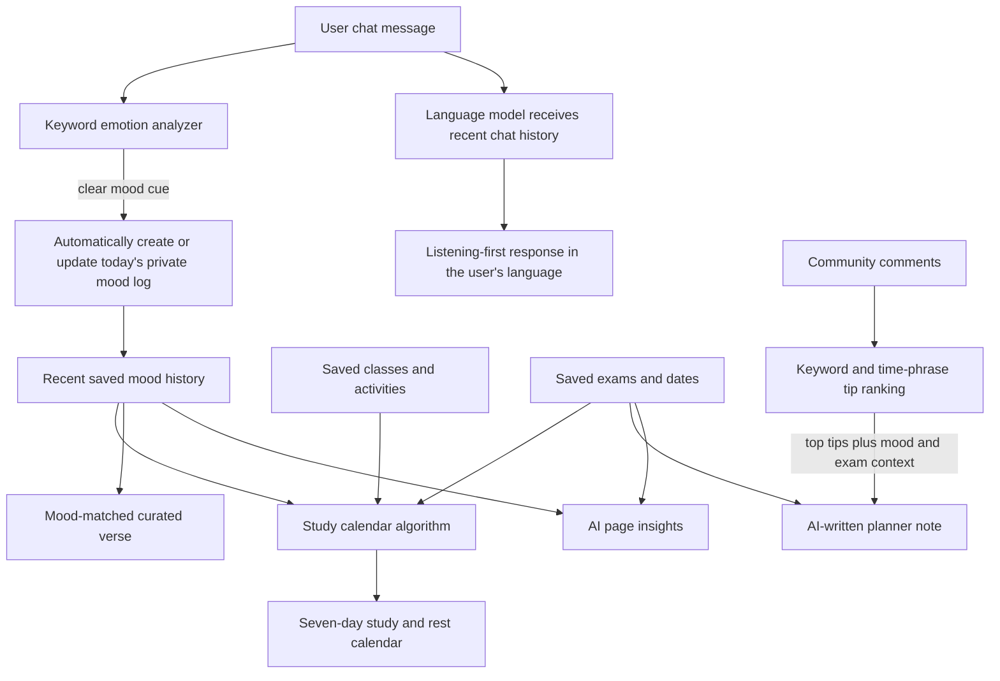

# Binetna

**An AI-supported wellbeing companion for women in Tunisian higher education and early careers.** Built as an MVP for the HERwin Hackathon.

## The problem

Women studying at university or starting their careers can face exam pressure, job-search uncertainty, burnout, and social expectations while finding it difficult to access private, relevant support. Binetna is designed as an approachable, non-diagnostic space for emotional check-ins and practical wellbeing tools.

## The solution

Binetna brings a listening-first AI companion, private mood tracking, an anonymous-alias community, and everyday wellbeing tools into one web app.

A typical user flow is:

1. Create an account and choose a private profile name.
2. Share what is on their mind with Folla in English, French, Tunisian Derja, Arabizi, or Arabic.
3. See a tentative keyword-based mood signal reflected in the private daily mood log when a clear emotion is present.
4. Use the journey tracker, private notes, self-care resources, community, and study planner as needed.

The chat is intended to listen and reflect. It does not diagnose, prescribe, or give unsolicited advice. The separate study planner can produce study and rest suggestions.

## AI analyzer: how context flows through Binetna

Binetna combines a language model with small, explainable app algorithms. The language model does more than produce chat replies, while the mood, calendar, quote, and community ranking calculations remain visible and predictable. In this README, **AI analyzer** means this full pipeline; it does not mean every feature is generated by an LLM.



| Part of the analyzer               | What happens                                                                                                                                                                                                                                                                          | Role of the language model                                                                                                                                                                                                          |
| ---------------------------------- | ------------------------------------------------------------------------------------------------------------------------------------------------------------------------------------------------------------------------------------------------------------------------------------- | ----------------------------------------------------------------------------------------------------------------------------------------------------------------------------------------------------------------------------------- |
| Chat understanding and mood signal | The server checks the current message against a small keyword lexicon. The latest clear cue wins, with common negations filtered.                                                                                                                                                     | The tentative signal and recent mood average are supplied alongside recent chat history so Folla can respond with context.                                                                                                          |
| Automatic mood tracking            | Clear sadness/fatigue cues map to 1, stress/anxiety to 2, and joy to 5. The server creates or updates that day's private log; neutral messages do not invent a mood entry.                                                                                                            | The model does not set the tracker value. The app's keyword analyzer applies the mapping, including when the provider is unavailable.                                                                                               |
| Study calendar                     | The scheduler builds seven days of class, study, exam, and rest blocks from the saved timetable, upcoming exams, recent mood logs, and its existing cycle-phase rules. A chat can affect the plan indirectly when its detected mood is saved and included in the recent mood history. | The model writes a short note for the plan using mood/cycle context, exam details, and selected community tips. The schedule blocks themselves are produced by the app algorithm; raw chat transcripts are not sent to the planner. |
| Page insights                      | The app requests a short insight for the current page using recent mood, page, cycle phase, next exam, and community-tip count.                                                                                                                                                       | The configured provider writes the insight. If it is unavailable, the app uses a short rule-based fallback.                                                                                                                         |
| Verse and quote card               | A verse is chosen from a curated collection based on the current mood value. The user can choose another mood or verse.                                                                                                                                                               | This selection is rule-based and the verse text is curated; the LLM does not generate or rank scripture.                                                                                                                            |
| Community recommendations          | The app scores comments for organization, schedule, break, sleep, and time-management terms, plus time-duration phrases. It filters and ranks the comments and displays the top four tips.                                                                                            | The scoring/ranking is currently a deterministic algorithm, not an LLM classifier. The top three selected tips can be included as context when the model writes a study-plan note.                                                  |

This separation lets the app update mood and build a calendar consistently, while using the language model for language understanding, empathetic conversation, and contextual writing. It also makes the current AI boundary explicit: the chat classifier, schedule builder, verse selection, and comment ranking are app algorithms, not clinical or model-generated judgments.

## AI provider and safety

- The browser calls the Express `/api/chat` route. The server calls the configured provider; credentials stay in `.env` and are never sent to the browser.
- OpenRouter is the default provider in `.env.example`. The server also supports Gemini, Groq, OpenAI, and Anthropic through `AI_PROVIDER`, `AI_API_KEY`, and optional `AI_MODEL` settings.
- Folla is prompted to answer in the user's language. When a user writes in Tunisian Derja, including Arabizi or mixed Darja/French, the prompt prioritizes a Darja reply and asks the model to match the user's script when possible.
- The chat is intended to listen and reflect. The chat prompt forbids unsolicited advice and does not use cycle phase to explain the user's feelings. The separate study planner is allowed to produce study and rest suggestions.
- Crisis-related keywords trigger a brief safety response, including SAMU 190 guidance for Tunisia, without sending that message to the provider. This is a basic keyword safeguard, not emergency monitoring.
- If the chat provider is unavailable, chat returns a clear service error instead of pretending a local reply came from the AI. A detected mood signal may still be saved. The planner note and page insights have rule-based fallbacks.

AI output and keyword signals can be wrong or incomplete. Binetna is a prototype, not a medical service or replacement for professional care.

## Features

- Private account sign-in and profile settings.
- Folla AI chat and private daily mood chart.
- Cycle tracker and self-care page with prayer tools and reflections.
- Anonymous-alias community posts, comments, and reactions.
- Private notes and achievements.
- Class timetable, exams, and a study/rest planner informed by the user’s schedule.
- English, French, and Arabic interface translations, including right-to-left layout. The AI prompt also supports Tunisian Derja and Arabizi replies.

## Tech stack

- Node.js 18 or newer
- Express 4
- HTML, CSS, and vanilla JavaScript
- JSON file storage at `data/db.json`
- OpenRouter by default, with optional Gemini, Groq, OpenAI, or Anthropic providers

There is no separate backend service or database server to configure. Express serves both the static app and the API.

## Setup on Windows PowerShell

1. Install Node.js 18 or newer.
2. Open PowerShell in the project folder:

   ```powershell
   cd C:\herwell-fullstack-v2\herwell
   ```

3. Install the locked dependencies:

   ```powershell
   npm ci
   ```

4. Create `.env` from the example if it does not already exist, then edit it:

   ```powershell
   if (-not (Test-Path .env)) { Copy-Item .env.example .env }
   notepad .env
   ```

   The default configuration uses OpenRouter. Set `AI_API_KEY` to your provider key. Keep the key in `.env`; never paste it into source code, screenshots, or GitHub. `.env` is ignored by Git.

5. Start Binetna:

   ```powershell
   npm start
   ```

6. Open [http://localhost:3002](http://localhost:3002) and create an account.

The `.env.example` file lists the provider variables. To use another supported provider, set `AI_PROVIDER`, `AI_API_KEY`, and, when needed, `AI_MODEL`. Restart the server after changing `.env`. User profiles and app data are stored locally in `data/db.json`.

## Manual demo checklist

- Create an account and sign in.
- Send a short English message and confirm Folla responds conversationally without unsolicited recommendations.
- Send a Tunisian Derja or Arabizi message and check that Folla replies in Darja.
- Send a clear positive or difficult mood statement and confirm the private daily mood chart reflects the keyword signal.
- Refresh the app and confirm account data persists locally.
- Confirm community posts show an alias rather than the profile name.
- Confirm the configured AI key is not present in browser files or committed files.

Use synthetic or consented demo data. The hackathon brief separately requires a 5–7 slide presentation and a live demo. Its suggested pitch timing is 5 minutes for the presentation, 3 minutes for the demo, and 2 minutes for questions.

## GitHub submission checklist

Before publishing, check that `.env`, `data/`, and `node_modules/` are ignored and that `.env.example` contains no real key. Review the staged file list before committing.

From the project folder in PowerShell:

```powershell
git init
git add .gitignore .env.example package.json package-lock.json README.md server.js public
git status --short
git commit -m "Prepare Binetna hackathon MVP"
git branch -M main
git remote add origin https://github.com/<your-account>/<your-repository>.git
git push -u origin main
```

Replace the remote URL with the GitHub repository you create. Do not add `.env` or `data/` to the commit.

## Project files

```text
server.js           Express server, API routes, authentication, and AI provider proxy
public/index.html   App interface and styles
public/api.js       Browser-to-API integration
public/i18n.js      English, French, and Arabic interface translations
public/extras.js    Decorative butterfly and sound controls
public/faith.js     Self-care, prayer, Qur'an, profile, and settings tools
.env.example        Safe template for local AI configuration
```

## Privacy and safety notes

Passwords are hashed with Node’s `scrypt`, and community content uses an alias. The prototype stores profile data and mood logs in a local JSON file; those records are not encrypted at rest. Chat messages are sent to the selected AI provider when the service is configured. Do not use real sensitive health data in a public demo.

Binetna is non-diagnostic and is not a medical service. The app’s crisis response is a basic keyword-triggered safeguard, not emergency monitoring. For real-world use, the team should review local data-protection requirements, strengthen moderation and security, and seek qualified review of wellbeing and religious content.

## Hackathon requirements covered

The project README documents the challenge problem, solution, AI role, how to run the app, and tech stack. The source code is intended to be submitted as a GitHub repository. Slides and a live demo are separate deliverables in the hackathon brief.
